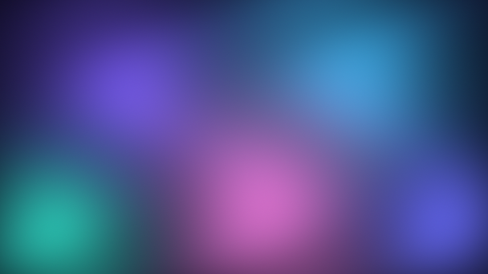

# ◈ ReqriumOS

An Arch Linux based OS with a **liquid glass** desktop: frosted translucent
windows, a floating glass panel, and soft, bouncy animations everywhere.



## What makes it "liquid glass"

| Piece | What it does |
|---|---|
| **Hyprland** (compositor) | 4-pass blur with vibrancy and grain behind every translucent surface, rounded squircle corners, soft shadows, and a gradient border that slowly rotates around the focused window |
| **Animations** | Windows pop in with a jelly overshoot and drip away on close. Workspaces glide vertically. Panels and menus float in. |
| **Waybar** | A floating glass panel made of glass "pills". The active workspace stretches like liquid. |
| **Rofi** | Frosted app launcher, clipboard picker and power menu |
| **Hyprlock** | Lock screen with a big clock and a glass password field over your blurred desktop |
| **Mako** | Glass notifications |
| **swww** | Wallpapers change with a wave ripple that starts at your cursor |
| **Kitty** | Translucent terminal with the Reqrium Night colour palette and a cursor trail |

## Install

### Option A: on an existing Arch install
```bash
git clone https://github.com/nullianz/night-chatbox
cd night-chatbox/ReqriumOS
./install.sh
```
Your old configs are backed up to `~/.config-backup-reqrium-*`. Reboot and
log in through the ReqriumOS greeter.

### Option B: build the ReqriumOS ISO
On an Arch machine:
```bash
sudo pacman -S archiso
sudo ./iso/build.sh
```
The ISO is written to `out/`. Boot it from a USB stick (or a VM with 3D
acceleration) and the glass desktop starts on its own. To install it to disk:
run `archinstall`, then `reqrium-postinstall`, then reboot.

## Shortcuts

| Keys | Action |
|---|---|
| `SUPER + Space` | App launcher |
| `SUPER + Return` | Terminal |
| `SUPER + E` | Files |
| `SUPER + Q` | Close window |
| `SUPER + F` / `V` | Fullscreen / float |
| `SUPER + 1…9` | Switch workspace (`+ SHIFT` moves the window) |
| `SUPER + S` | Glass drawer (scratchpad) |
| `SUPER + W` | Next wallpaper (ripple transition) |
| `SUPER + C` | Clipboard history |
| `SUPER + L` | Lock |
| `SUPER + SHIFT + S` | Screenshot a region |
| `SUPER + SHIFT + E` | Power menu |

## Customising

- **More or less glass:** change `decoration { active_opacity, inactive_opacity, blur { passes, vibrancy } }` in `dotfiles/hypr/hyprland.conf`.
- **Animation speed:** the number after `1,` in each `animation =` line (lower is faster).
- **Wallpapers:** put images in `~/.config/reqrium/wallpapers/`.

## Notes

- Blur needs a GPU with working 3D drivers. In VirtualBox or VMware, enable 3D acceleration. In QEMU, use `-device virtio-vga-gl -display gtk,gl=on`.
- The configs target recent Hyprland (0.4x/0.5x). Hyprland changes its config syntax from time to time, so if it shows a config error banner, check the
  [Hyprland wiki](https://wiki.hypr.land) for the renamed option.
