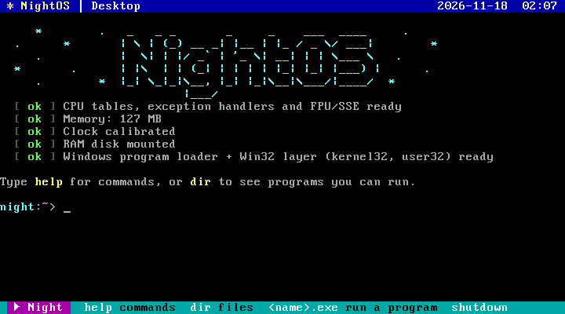
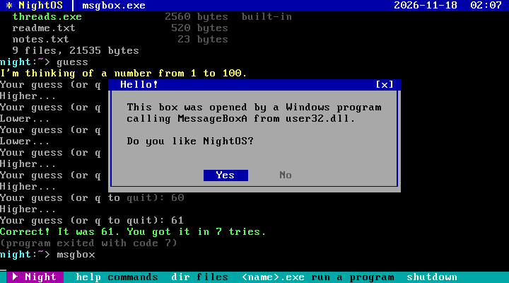

# NightOS

A tiny operating system written from scratch that runs Windows `.exe` programs directly, without Wine, Windows code or any Microsoft files.

NightOS boots on a 32-bit x86 PC (or QEMU/VirtualBox). It includes its own loader for Windows **PE32** executables and its own implementation of part of the Win32 API (`kernel32.dll` and `user32.dll`). When you run a `.exe`, NightOS maps the program into memory, applies its relocations, and connects every function it imports to NightOS's own versions.





## Try it

```sh
make            # kernel + demo programs  -> build/nightos.elf
make run        # boot it in QEMU
make iso        # bootable CD image       -> nightos.iso (boots in VirtualBox, QEMU, or a USB stick)
make test       # boot headless and run the automated test suite
```

Build requirements: `gcc` (with `-m32`), `nasm`, `ld`, `clang`, `lld-link`, `llvm-dlltool`, plus `grub-mkrescue` and `xorriso` for the ISO, and `qemu-system-i386` to run it.

At the `night:~>` prompt:

| Command | What it does |
|---|---|
| `dir` | list files |
| `hello`, `guess`, `notes`, `msgbox`, `sysinfo` | run the demo `.exe` programs |
| `crash` | a program that divides by zero; NightOS closes it and keeps running |
| `threads` | calls a Win32 function NightOS doesn't have yet; you get a clear message |
| `info <exe>` | look inside an `.exe` and see which of its imports NightOS supports |
| `type`, `del`, `echo`, `cls`, `mem`, `time`, `ver`, `msg` | the usual |
| `reboot`, `shutdown` | |

The demo programs in `apps/` are ordinary 32-bit Windows console programs built with clang and lld-link (they run on real Windows too). They are compiled against `apps/night.h`, a small header written for this project, not the Windows SDK.

## What's inside

| File | Purpose |
|---|---|
| `boot/boot.asm` | Multiboot entry point; enables the FPU and SSE |
| `boot/cpu.asm` | GDT/IDT loading, exception stubs, setjmp/longjmp, stack switching |
| `kernel/cpu.c` | GDT (including an FS segment pointing at a thread block, which Windows programs expect), IDT, crash handling |
| `kernel/pe.c` | the `.exe` loader: header checks, section mapping, base relocations, import binding |
| `kernel/win32.c` | NightOS's Win32 layer: console and file I/O, heap, time, strings, `MessageBoxA`, `wsprintfA` and more |
| `kernel/fs.c` | RAM filesystem (built-in programs and any files you create) |
| `kernel/console.c`, `input.c` | VGA text desktop, PS/2 keyboard, serial port |
| `kernel/mem.c`, `time.c`, `lib.c` | heap allocator, clock, tiny C library |

## Honest limitations

This is a working hobby OS, not a replacement for Windows. Today:

- Programs can only use the ~40 Win32 functions listed in `kernel/win32.c`. Most real-world apps (games, browsers, Office) need thousands of functions, plus DirectX, the C runtime DLLs, threads, the registry and a graphical window system. Use `info <exe>` to see what a program needs.
- Only 32-bit `.exe` files; 64-bit programs are rejected with a message.
- Text mode only (no graphics or mouse), one program at a time, no disk or network drivers. Files live in RAM and are gone after a reboot.
- Programs run in the same privilege level as the kernel (no memory protection yet). Crashes are caught and the program is closed, but a hostile program could still damage the system.

Good next steps: paging and user mode, a FAT driver so `.exe` files can be loaded from disk, more of `kernel32`, `msvcrt.dll`, and a graphics mode with a window manager.
